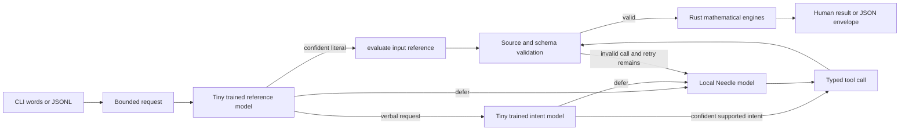

# How a request becomes a calculation

The reference model is a small trained MLP implemented directly in Rust. It
selects `evaluate()` with no generated expression. The validator extracts the
original literal expression after removing recognized conversational wrappers;
every number, unit, operator, and parenthesis stays intact. Its weights and
training/inference parity checks are in `training/reference-v2/`.

A second MLP recognizes a conservative subset of verbal arithmetic. A generic
lexer copies the original numeric operands into its selected tool and preserves
their signs and spelling. The learned class determines the operation and operand
order. Unknown words, units, compositions, low confidence, or a failed source
check defer to Needle. Its weights and evaluation are in `training/intent/`.
If original wording defers, the same classifier can also see the request with
recognized conversational wrappers removed. Every proposed call is still
validated against the complete original input; operands are copied unchanged.

Requests that need interpretation use Needle's local native runtime. The model
selects one of the tools in `assets/tools.json`: reference evaluation, a named
function with operands, a unit conversion, or a symbolic/calculus operation.
Model-produced operands are checked against the source request. These checks
are deliberately conservative and can reject a valid interpretation that they
cannot establish. The reported expression makes accepted interpretations
reviewable.

The model never computes an authoritative answer. `fend-core` provides exact
scalar arithmetic, complex values, and units. Rust modules add numerical
statistics, probability distributions, vectors, matrices, numerical calculus,
and exact rational symbolic manipulation. A result distinguishes exact values
from finite-precision numerical outputs. Mathematical domain errors terminate
the request; changing the question is not a recovery strategy.

## Process boundary

The `calc` client connects to its own owner-only Unix socket. A worker keeps
model state and cached tool-prefix processing between invocations, resets the
conversation before each prediction, and handles independent requests. Model
loading is lazy. There is no network service or remote API.

The client tracks a total deadline; workers have an address-space bound and a
process watchdog. A hung or crashed native runtime is contained in the worker.
Transport failures can restart the worker within the same request's retry and
time budgets. A fresh-process mode is available with `--no-daemon`.

The two tiny classifiers and the generative model are separately identifiable in
JSON. `--backend needle` bypasses the fast classifiers for reproducible model
experiments. No query-result cache is used: benchmarks issue new quantities and
measure a real prediction and calculation on every request.

## Verification boundaries

- Mathematical tests use independent identities, exact values, and domain
  counterexamples; model accuracy cannot hide numerical defects.
- Planner tests inject malformed and subtly altered tool calls and verify
  bounded retries, source preservation, and error behavior.
- Model evaluations retain generated calls and count rejected/mistaken outputs,
  with separate generated and manually written cases.
- `scripts/verify_cli.py` executes golden requests through the real CLI and
  records the executable/model/data hashes and actual mathematical answers.
- `scripts/benchmark.py` measures cold startup, first verbal and generative
  requests, and unique warm requests separately, including correctness and
  worker memory. Backend names distinguish the measured paths.

Synthetic held-out metrics describe the measured distributions, not universal
English understanding. Native confidence is not a correctness guarantee;
fine-tuned Needle's original confidence head is not calibrated for Omni.
